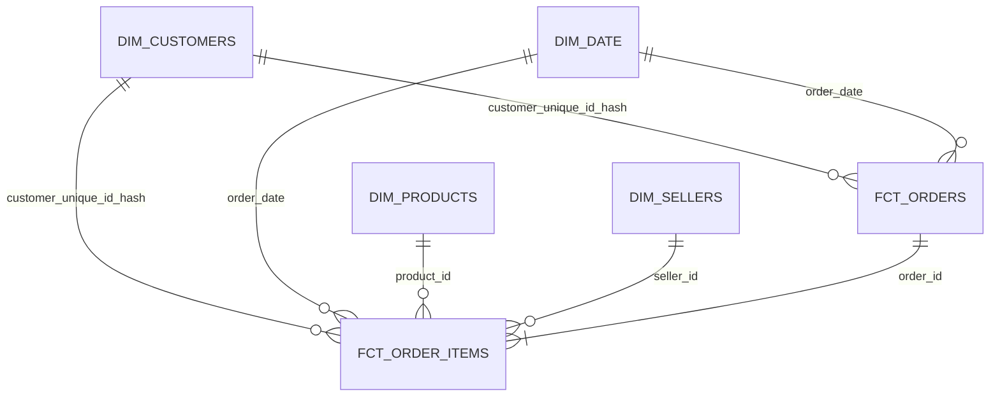

# olist analytics

olist brazilian e-commerce data. snowflake for storage, dbt cloud for transformations, power bi for the dashboard.

## net revenue

price + freight for every item. canceled and unavailable orders are 0.

```sql
case
    when order_status in ('canceled', 'unavailable') then 0
    else coalesce(product_revenue, 0) + coalesce(freight_revenue, 0)
end as net_revenue
```

I compared items with payments before choosing. 98362 of 98665 orders have the same total.
264 orders paid more, they have more installments (6.3 vs 2.9 avg). 39 paid less, no reason found.
I used items because payments can not be split by product or seller.

total is 15,735,527.03 in fct_orders, fct_order_items and from staging. checks in `analyses/net_revenue_check.sql`.

## model

raw -> staging -> intermediate -> marts

raw is loaded with copy into, everything varchar. staging renames, casts and hashes the customer id.
intermediate groups payments, reviews and items to one row per order, so the joins in marts don't duplicate rows.
marts is a star schema.

fct_orders is one row per order (incremental, merge on order_id).
fct_order_items is one row per item, because 1278 orders have more than one seller.
both use the same dim_customers and dim_date.



## tests

unique, not_null, relationships and accepted_values on the models, source freshness on raw.
two singular tests in `tests/`. one of them warns for 8 delivered orders without delivery date.
610 products without category are also a warning.

## security

customer_unique_id is hashed. power bi uses role reporter, it can read only marts.
dbt and power bi have their own service users with key-pair.

## ci/cd

every pr runs the changed models and their tests in dbt cloud. merge to main runs the production build.

## power bi

reads from `analytics.prod_marts`. the .pbit file is a template without data.

